# game_check_app

여러 게임을 동시에 플레이하는 게이머를 위한 일일, 주간, 월간 퀘스트 및 목표 관리 앱입니다.

로그인 없이 기기에만 저장해서 바로 쓸 수 있고, 로그인하면 기기 데이터를 계정으로 옮겨 클라우드에 저장합니다.

## 목차

- [기술 스택](#기술-스택)
- [환경정보](#환경정보)
- [아키텍처](#아키텍처)
- [주요 화면 및 기능](#주요-화면-및-기능)
- [트러블슈팅](#트러블슈팅)
- [실행방법](#실행방법)

## 기술 스택

- 프레임워크 : Flutter
- 상태관리 : Provider
- 라우팅 : go_router (`StatefulShellRoute`로 하단 탭별 스택 유지)
- 로컬 DB : Drift
- 클라우드 DB : Firebase Firestore
- 인증 : Firebase Authentication (이메일 / Google 로그인)
- 사진 저장 : Firebase Storage (프로필 이미지, 문의 첨부 이미지)
- ID 생성 : uuid (v4)
- 로컬 설정 : shared_preferences (온보딩 완료 여부)
- 캘린더 : table_calendar

## 환경정보

### 대상 플랫폼

Android (Google Play Store)

### 로컬 DB 엔진

drift 2.32+ 기준 (sqlite3)

- DB 파일 : 앱 문서 폴더의 `game_quest_checklist.sqlite` (백그라운드 isolate로 연결)
- 스키마 버전 : 2

### Firebase 연동 (클라우드 DB, 인증, 스토리지)

Firebase 프로젝트 연동 필요 (google-services.json 등 설정 파일 별도 추가)

Google 로그인의 `serverClientId`는 코드에 넣지 않고, `env.json` 파일의 값을 `--dart-define-from-file`로 전달합니다. ([실행방법](#실행방법) 참고)

## 아키텍처

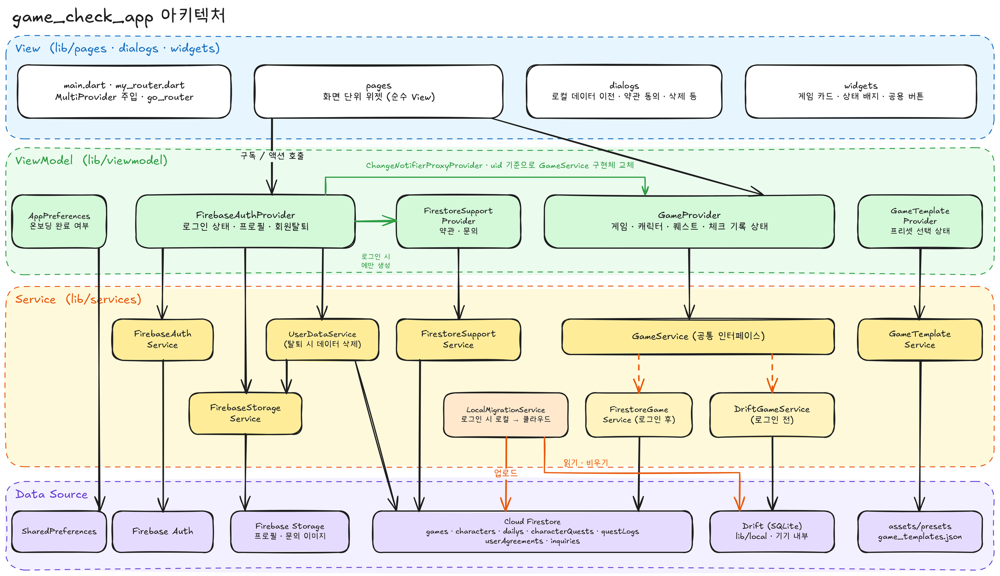

> 다이어그램 원본: [`images/architecture.excalidraw`](images/architecture.excalidraw) — [excalidraw.com](https://excalidraw.com)에서 열어 수정할 수 있습니다.

### 구조

기본적으로 pages → viewmodel(provider) → services → DB

- main.dart / my_router.dart: 앱 시작점. `MultiProvider`로 의존성을 주입하고, go_router로 화면 이동과 로그인 여부에 따른 redirect를 처리
- pages: 순수 View. 화면 단위 위젯만 담당
- viewmodel/provider: 화면별 상태와 로직. services를 조합해 화면에 필요한 상태를 만듦
  - `GameProvider`: 게임 · 캐릭터 · 퀘스트 · 체크 기록
  - `FirebaseAuthProvider`: 로그인 상태, 프로필, 회원탈퇴
  - `GameTemplateProvider`: 온보딩 / 템플릿 선택 상태
  - `FirestoreSupportProvider`: 약관 동의, 문의 (로그인 상태에서만 생성)
  - `app_preferences.dart`: 온보딩 완료 여부 (shared_preferences)
- widgets: 여러 페이지에서 공통으로 쓰이는 UI 컴포넌트 및 위젯을 한곳에 모아둔 폴더
- dialogs: 다이얼로그를 한곳에 모아둔 폴더 (로컬 데이터 이전, 약관 동의, 게임 삭제, 템플릿 선택, 재인증)
- services: 데이터 CRUD(로그인 전 Drift ↔ 로그인 후 Firestore 전환 포함)와 Firebase Auth / Storage, 로그인 마이그레이션, 회원탈퇴 데이터 삭제까지 전부 이 폴더에서 처리
- local: Drift 스키마 전체 — 테이블 정의(tables/)와 커스텀 컬럼 변환기(converters/)로 구성
- models: 도메인 모델과 enum
- theme: 앱 공통 색상 정의 (상태 색: 완료=파랑, 부분=주황, 미완료=빨강, 없음=회색)
- utils: 특정 화면에 종속되지 않는 유틸 함수 (퀘스트 기간 계산, 스낵바)

```
lib/
├── main.dart        # 시작점, MultiProvider 의존성 주입
├── my_router.dart   # go_router 라우팅, redirect
├── dialogs/    # 다이얼로그 모음
├── local/      # Drift 로컬 DB
│   ├── tables/       # Drift 테이블 정의
│   └── converters/   # 커스텀 타입 컨버터 (예: List<String> ↔ JSON)
├── models/     # 도메인 모델
├── pages/      # 화면 위젯(View)
├── services/   # 데이터 CRUD(Drift/Firestore) + 외부 동작 트리거 (Auth, Storage, 로그인 마이그레이션, 탈퇴)
├── theme/      # 앱 공통 색상
├── utils/      # 유틸 함수 (퀘스트 기간 계산 등)
├── viewmodel/
│   ├── app_preferences.dart   # 온보딩 완료 여부
│   └── provider/   # 화면별 로직 (Provider/ChangeNotifier), services를 조합해 상태를 만듦
└── widgets/    # 여러 화면에서 재사용하는 공용 위젯 및 위젯 모음
```

### 저장소 교체 방식 (GameService)

`GameService`라는 공통 인터페이스 아래에 구현체가 두 개 있습니다.

- `DriftGameService`: 로그인 전, 기기 내부 SQLite에 저장
- `FirestoreGameService`: 로그인 후, 해당 uid의 데이터만 Firestore에 저장 / 조회

`main.dart`의 `ChangeNotifierProxyProvider`가 로그인한 사용자의 **uid가 바뀔 때만** `GameProvider`를 새 구현체로 교체합니다. `GameProvider`와 화면 코드는 어느 저장소를 쓰는지 모르기 때문에, 게임 화면은 로그인 여부와 관계없이 같은 코드로 동작합니다.

### 데이터 저장소 전환 정책

로그인 전(Drift)과 로그인 후(Firestore)는 동시에 원본 데이터로 취급하지 않으며, 로그인 시점에 로컬 데이터를 계정으로 업로드(또는 폐기)하는 마이그레이션 절차를 거쳐 저장소 주도권이 완전히 전환됩니다.

- 기기에 데이터가 있으면 **계정에 저장 / 버리기 / 로그인 취소** 중 선택 (신규 가입이면 취소 없음)
- 계정에 저장: **먼저 업로드하고, 업로드가 성공한 뒤에** 로컬에 없는 클라우드 게임을 삭제 → 업로드 중 실패해도 기존 계정 데이터는 안전
- 저장 · 버리기 후에는 로컬 DB를 비우고 클라우드 데이터를 다시 불러옴
- 처리 중 실패하면 로그아웃하고 로컬 데이터는 그대로 보존
- 모든 모델이 UUID를 id로 쓰고 Firestore 문서 ID도 같은 UUID를 사용하므로, 업로드 후에도 게임 · 캐릭터 · 퀘스트 · 체크 기록 간 참조가 그대로 유지됨

### 퀘스트 초기화(기간) 계산

체크 기록(`QuestLog`)은 퀘스트 · 캐릭터 · **기간(`periodDate`)** 단위로 저장되고, 기간은 `utils/quest_period.dart`에서 게임별 초기화 설정을 반영해 계산합니다.

| 구분 | 기간 기준 |
| --- | --- |
| 일일 | 게임상 오늘 (`todayPeriodFor`) — 초기화 시각 이전이면 어제로 계산. 예: 06:00 초기화 게임을 03:00에 하면 아직 어제 퀘스트 |
| 주간 | 주의 시작일 (`weekStartFor`) — 게임상 오늘에서 주간 초기화 요일까지 거슬러 올라간 날짜 |
| 월간 | 그 달 1일 |
| 목표 | 마감일 |

초기화 시각이 지나면 새 기간의 기록을 조회하게 되므로 체크가 자동으로 풀린 것처럼 보입니다. 같은 기간에 체크를 껐다 켜도 기존 기록의 id를 재사용해 기록이 중복 생성되지 않습니다.

### 핵심 흐름

- **체크 한 번 누르기** : `game_detail_page` → `GameProvider.updateQuestLog` → `GameService.upsertQuestLog`(Drift 또는 Firestore) → 메모리 갱신 → `notifyListeners` → 화면 반영
- **로그인** : `login_page` → `FirebaseAuthProvider.signIn` → ProxyProvider가 `GameProvider`를 `FirestoreGameService`로 교체 → 로컬 데이터 처리 선택 → 클라우드 데이터 로드 → 홈 탭 스택 초기화
- **온보딩** : 게임 타입 선택 → 프리셋 선택 → 미리보기 → 프리셋으로 게임 생성 → 온보딩 완료 저장 → 메인

## 주요 화면 및 기능

### 게임 메인 페이지

<table>
  <tr>
    <td align="center">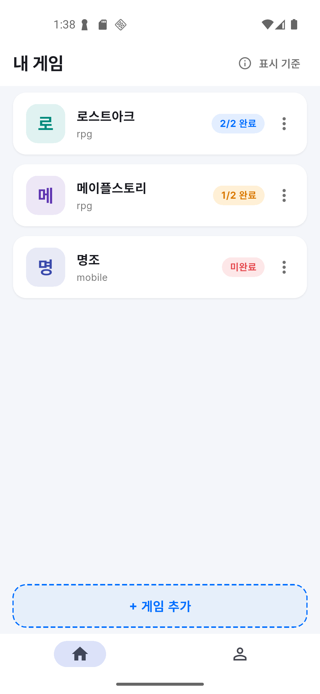</td>
    <td align="center">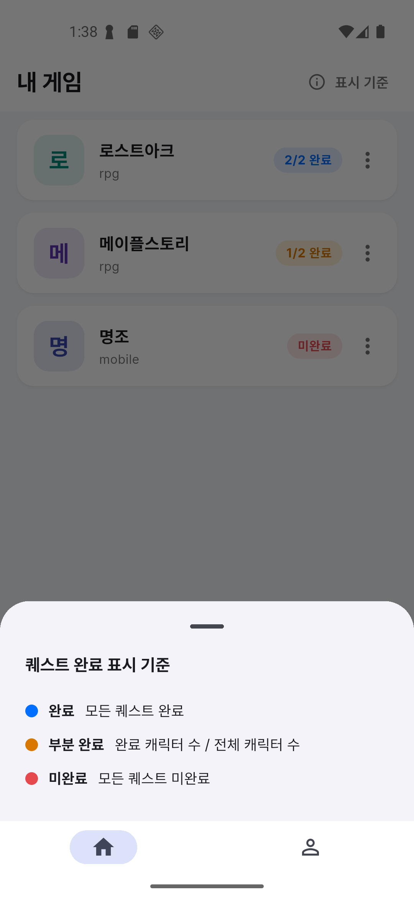</td>
  </tr>
  <tr>
    <td align="center">게임 목록</td>
    <td align="center">퀘스트 완료 표시 기준</td>
  </tr>
</table>

- 내가 설정한 게임 목록 표시 (이름, 타입 및 오늘의 일일 퀘스트 상태)
  - 상태 배지: 모든 캐릭터 완료 시 "완료", 일부만 완료 시 "완료 캐릭터 수 / 전체 캐릭터 수", 없으면 "미완료"
- 게임 카드 클릭 시 → 게임 상세 페이지로 이동
- 더보기 아이콘 클릭 시 → 삭제 버튼 표시 및 게임 삭제
- 게임 추가 버튼 클릭 시 → 게임 설정 페이지로 이동
- 표시 기준 아이콘 클릭 시 → 퀘스트 완료 표시 기준 안내
- 로그인 / 로그아웃으로 저장소가 바뀌면 목록을 자동으로 다시 불러옴

### 게임 설정 페이지

<table>
  <tr>
    <td align="center">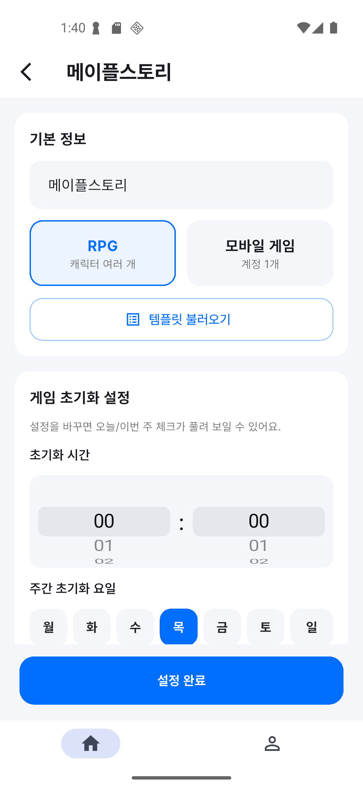</td>
    <td align="center">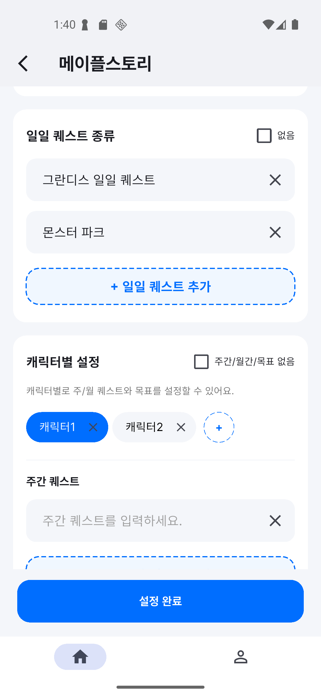</td>
    <td align="center">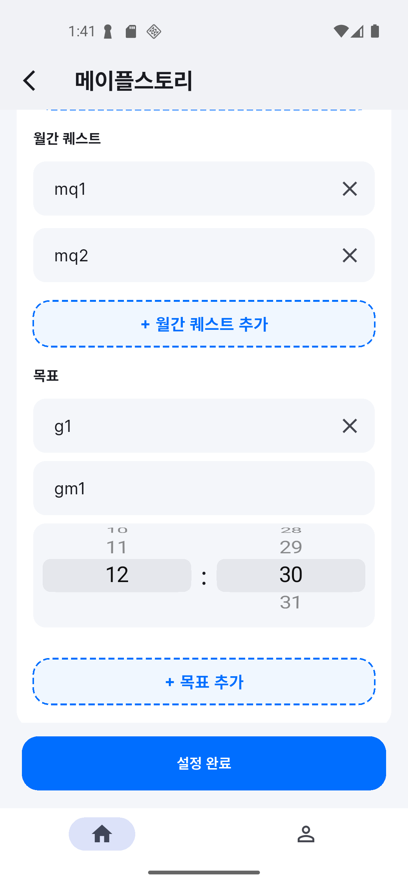</td>
  </tr>
  <tr>
    <td align="center">기본 정보 · 초기화 설정</td>
    <td align="center">일일 퀘스트 · 캐릭터별 설정</td>
    <td align="center">월간 퀘스트 · 목표</td>
  </tr>
</table>

- 게임 설정 입력 (새 게임 추가 / 기존 게임 수정 두 가지 모드)
  - 이름, 타입(RPG: 캐릭터 여러 개 / 모바일 게임: 계정 1개)
  - 초기화 시간, 주간 초기화 요일
  - 공통 일일 퀘스트
  - 캐릭터(칩에서 이름 편집 · 추가 · 삭제)와 캐릭터별 주간 / 월간 퀘스트 및 목표(마감일 · 메모)
- 템플릿 불러오기 선택 및 적용 (미리 입력된 템플릿을 불러오면 현재 입력 내용을 대체)
- 설정 완료 버튼 클릭 시 → 설정 내용 저장
  - 전부 지우고 다시 쓰지 않고 **바뀐 부분만 반영(추가 / 수정 / 삭제)** 하기 때문에, 수정해도 기존 퀘스트의 체크 기록이 유지됨

### 게임 상세 페이지

<table>
  <tr>
    <td align="center">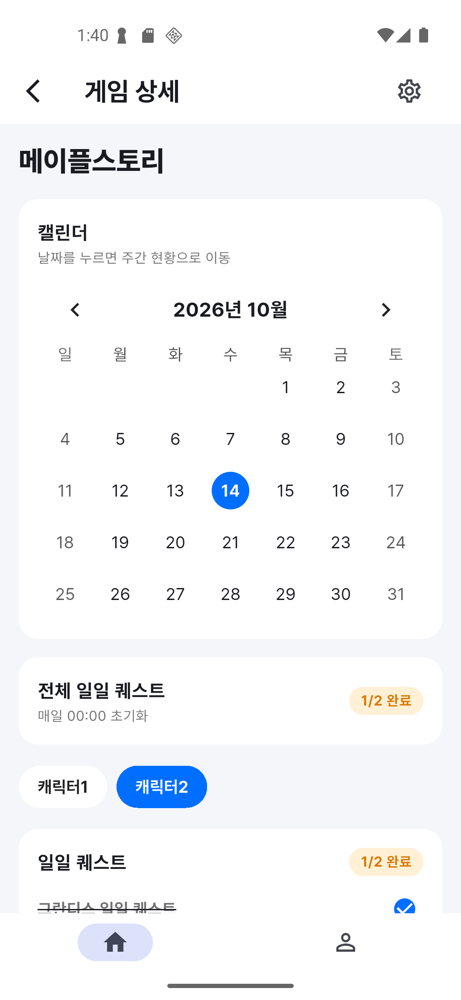</td>
    <td align="center">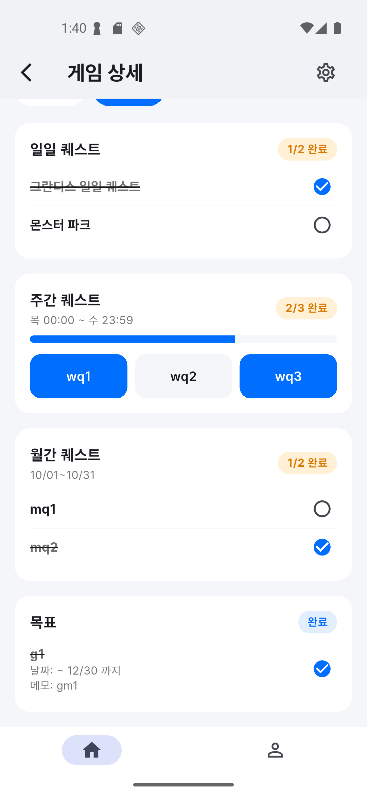</td>
  </tr>
  <tr>
    <td align="center">캘린더 · 전체 일일 퀘스트</td>
    <td align="center">캐릭터별 퀘스트 체크</td>
  </tr>
</table>

- 설정한 퀘스트(일일, 주간, 월간, 목표) 체크
  - 일일 퀘스트: 공통 퀘스트로, 같은 퀘스트를 캐릭터마다 각각 체크
  - 주간 / 월간 / 목표: 캐릭터마다 각각 체크
- 전체 일일 퀘스트 배지로 캐릭터별 일일 완료 현황 표시
- 주간 퀘스트는 진행 바와 초기화 범위(예: 목 00:00 ~ 수 23:59), 목표는 마감일과 메모 표시
- 캘린더의 날짜 클릭 시 → 주간 현황 페이지로 이동
- 화면을 켜둔 채로 초기화 시각이 지나면 새 기간 데이터로 다시 불러옴

### 주간 현황 페이지

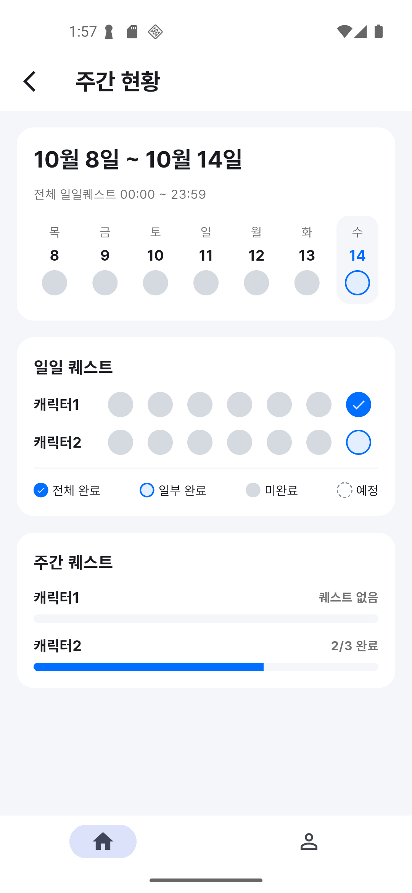

- 게임 체크 주간 현황 표시 (조회 전용)
- 1주일간 날짜별 전체 상태와, 모든 캐릭터의 일일 퀘스트 / 주간 퀘스트 진행 상태 표시
- 상태 표시: 전체 완료 / 일부 완료 / 미완료 / 예정(아직 오지 않은 날)

### 로그인 페이지

<table>
  <tr>
    <td align="center">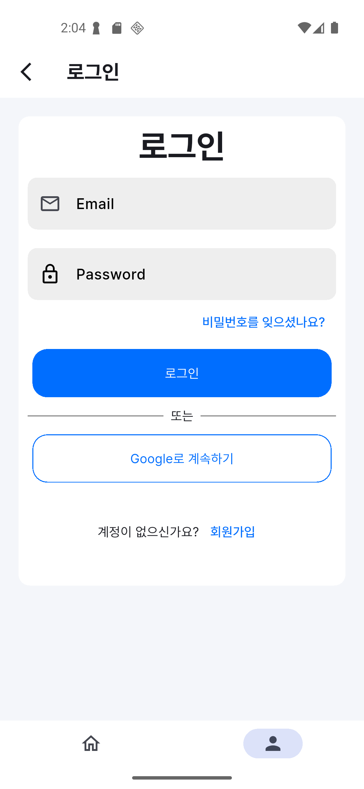</td>
    <td align="center">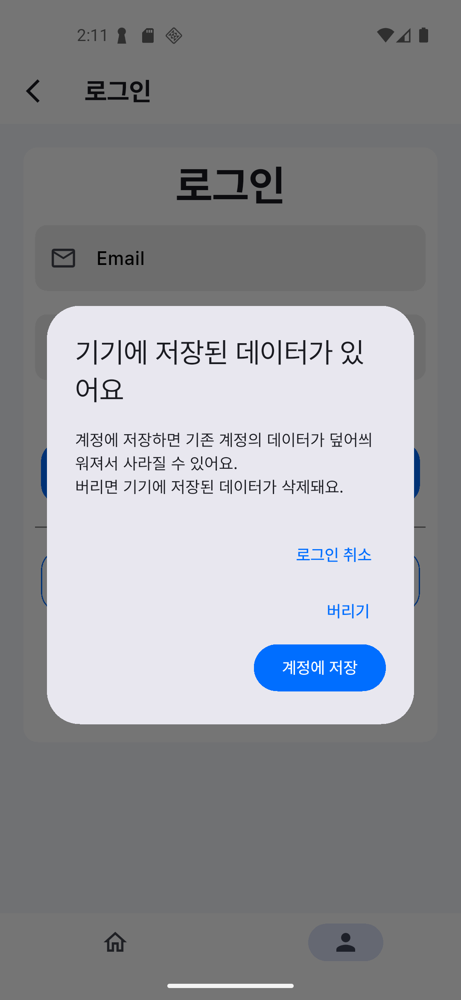</td>
  </tr>
  <tr>
    <td align="center">로그인</td>
    <td align="center">기기 데이터 이전 선택</td>
  </tr>
</table>

- 이메일, 비밀번호 입력 후 로그인
- 구글 소셜 로그인 버튼 클릭 시 → 소셜 로그인
  - 약관 동의 기록이 없으면 약관 동의 다이얼로그 표시. 동의하지 않으면 로그인을 취소하고, 방금 생성된 계정이면 계정도 삭제
- 기기에 저장된 데이터가 있으면 → 계정에 저장 / 버리기 / 로그인 취소 중 선택 ([데이터 저장소 전환 정책](#데이터-저장소-전환-정책))
- 비밀번호 찾기, 회원가입 페이지로 이동

### 회원가입 페이지

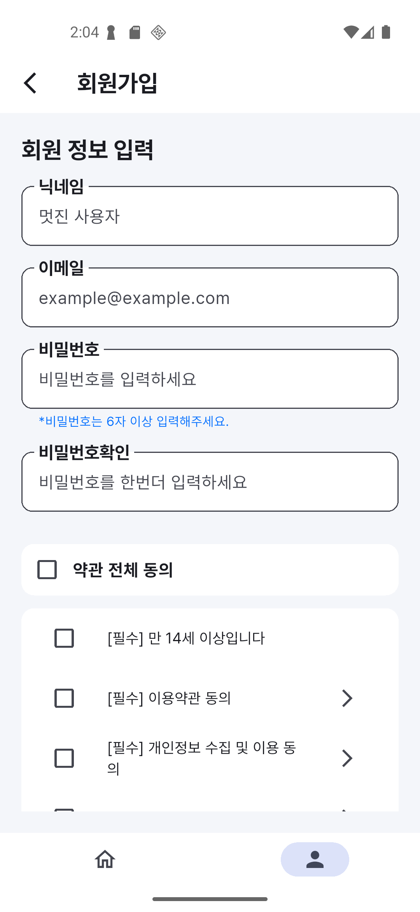

- 닉네임, 이메일, 비밀번호 입력 및 약관 동의 후 가입
  - 약관: 만 14세 이상 · 이용약관 · 개인정보 수집 및 이용(필수), 마케팅 정보 수신(선택)
  - 각 약관 옆 화살표로 약관 상세 보기
- 가입 후 약관 동의 정보를 저장하고, 기기에 데이터가 있으면 계정으로 이전할지 선택

### 마이 페이지

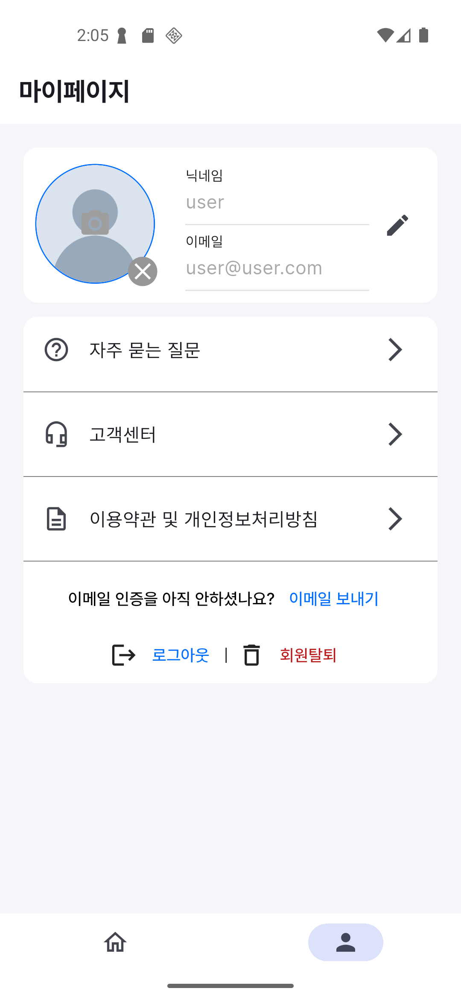

- 프로필 사진, 닉네임, 이메일 표시 (비로그인 시 로그인 안내)
- 프로필 사진 클릭 시 갤러리에서 사진을 골라 적용, X 버튼으로 삭제
- 연필 버튼으로 닉네임 편집 모드 전환 후 변경
- 자주 묻는 질문, 고객센터, 이용약관 페이지로 이동
- 이메일 인증 메일 발송, 로그인 / 로그아웃
- 회원 탈퇴: 재인증(이메일 계정은 비밀번호, 구글 계정은 구글 재로그인) 후 문의 · 게임 데이터 · 약관 동의 · 프로필 이미지를 먼저 지우고 계정 삭제

### 그 외 화면

| 화면 | 설명 |
| --- | --- |
| 온보딩 (3단계) | 최초 실행 시 게임 타입 선택 → 프리셋 게임 선택 → 미리보기 후 프리셋으로 게임 생성 |
| 비밀번호 재설정 / 메일 확인 | 재설정 메일 발송 및 재발송 |
| 자주 묻는 질문 | 태그 필터 + 펼침형 목록 |
| 고객센터 / 문의 작성 | 내 문의 목록(대기중 / 답변완료), 문의 작성(이미지 첨부 가능) |
| 이용약관 / 이용약관 상세 | 동의 내역 확인, 마케팅 수신 동의 변경 |
| 알림 설정 | UI만 구현된 상태 (기능 개발 예정) |

## 트러블슈팅

각 항목을 클릭하면 상세 내용(증상 · 원인 · 해결)을 볼 수 있습니다.

### 1. [로그인 상태에 따른 저장소 전환 (서비스 분리 + `ProxyProvider`)](docs/01-storage-switch-proxyprovider.md)

로그인 전에는 Drift, 로그인 후에는 Firestore에 저장해야 해서 Provider 곳곳에 분기문이 생김.
`GameService` 공통 인터페이스 아래 `DriftGameService` / `FirestoreGameService`로 저장소 구현을 분리.
`ChangeNotifierProxyProvider`로 사용자(uid)가 실제로 바뀔 때만 알맞은 서비스를 주입해 해결.

### 2. [Firebase Auth `reload()` 후 최신 유저 정보 반영](docs/02-firebase-auth-reload.md)

회원가입 직후 마이페이지에 이메일은 보이는데 닉네임이 비어 있음 (재로그인 시 정상 표시).
`currentUser`는 스냅샷이라 `reload()` 후 다시 읽어 변환하지 않으면 Provider 값이 예전 상태로 남음.
"`reload()` → `currentUser` 재변환 → `notifyListeners()`" 흐름의 `refreshUser()`로 해결.

### 3. [높이 제약 없는 곳의 `ListView` 오류 및 중첩 스크롤](docs/03-listview-unbounded-height.md)

`Column`/`SingleChildScrollView` 안의 `ListView`가 레이아웃 에러를 내거나 스크롤이 이중으로 동작함.
`ListView`는 무한한 공간을 요구하는데 부모는 높이 제약을 주지 않아 서로 크기를 미루는 것이 원인.
`Expanded`로 감싸거나 `shrinkWrap` + `NeverScrollableScrollPhysics` 조합으로 해결.

### 4. [`game_setup_page`에서 고정 크기 위젯의 오버플로우](docs/04-column-overflow.md)

캐릭터/퀘스트 항목을 계속 추가하면 고정 크기 영역을 넘어 오버플로우 에러가 발생함.
`Column`의 기본값 `MainAxisSize.max` 때문에 부모가 고정한 크기를 넘어설 수 없었던 것이 원인.
`mainAxisSize: MainAxisSize.min`으로 자식 크기만큼만 차지하도록 바꿔 해결.

### 5. [`TableCalendar` 사용법 (`onDaySelected`)](docs/05-table-calendar.md)

날짜를 선택해도 캘린더의 포커스(보여주는 달)는 자동으로 갱신되지 않음.
`focusedDay`(보여주는 달)와 `selectedDay`(선택한 날짜)는 별개의 값으로 관리됨.
`onDaySelected`의 `setState` 안에서 두 값을 모두 갱신해 해결.

### 6. [`Expanded` 안에서 고정 크기 위젯이 잘리는 문제](docs/06-expanded-tight-constraint.md)

`Expanded` 안의 고정 크기 `Container`가 지정한 크기대로 표시되지 않고 잘리거나 찌그러짐.
`Expanded`가 자식에게 tight constraint를 전달해 크기를 강제하는 것이 원인.
`Center`로 한 번 감싸 loose constraint로 바꿔 원래 크기를 유지하도록 해결.

### 7. [`ListTile`을 `Container`로 감쌀 때 뜨는 경고](docs/07-listtile-container-warning.md)

배경색을 주려고 `ListTile`을 `Container`/`DecoratedBox`로 감싸면 콘솔에 경고가 뜸.
`ListTile`의 잉크 효과가 부모의 배경색 위에 제대로 그려지지 못하는 충돌이 원인.
`tileColor` 속성을 사용하거나, `Material(color: Colors.transparent)`로 감싸서 해결.

### 8. [`TextFormField` 여러 줄 입력](docs/08-textformfield-multiline.md)

문의 작성처럼 긴 텍스트를 입력받아야 하는데 기본 `TextFormField`는 한 줄짜리 입력창임.
`minLines`, `maxLines`로 입력창 높이를 정하고, 키보드 타입과 엔터 동작을 줄바꿈용으로 설정.
`hintMaxLines`로 긴 힌트 텍스트도 여러 줄로 표시되도록 처리.

### 9. [스크롤 시 내부 위젯이 흔들리는 문제 (오버스크롤 글로우)](docs/09-overscroll-glow.md)

스크롤을 끝까지 당기면 안쪽 위젯이 잠깐 어긋나거나 커지는 듯 흔들려 보임.
안드로이드 기본 오버스크롤 글로우 효과가 레이아웃 리사이즈처럼 작동하는 것이 원인.
`ScrollConfiguration`으로 감싸고 `overscroll: false`로 효과를 꺼서 해결.

## 실행방법

### 1. 패키지 설치

```bash
flutter pub get
```

### 2. Drift 코드 생성 (테이블 정의 변경 시 반드시 재실행)

```bash
dart run build_runner build --delete-conflicting-outputs
```

개발 중에는 watch 모드를 사용합니다.

```bash
dart run build_runner watch --delete-conflicting-outputs
```

### 3. Firebase 설정

Firebase 프로젝트를 연동하고 `android/app/google-services.json`을 추가합니다.

### 4. 환경변수 파일(env.json) 만들기

프로젝트 루트의 `env.json.example`을 복사해 `env.json`을 만듭니다.

```bash
cp env.json.example env.json
```

`env.json`에 본인의 Google 웹 클라이언트 ID(Firebase 콘솔의 Google 로그인 설정에서 확인)를 넣습니다.

```json
{
  "GOOGLE_SERVER_CLIENT_ID": "YOUR_WEB_CLIENT_ID.apps.googleusercontent.com"
}
```

> `env.json`에는 개인 키 값이 들어가므로 `.gitignore`에 추가해 GitHub에 올리지 않습니다. 저장소에는 예시 파일인 `env.json.example`만 올라가 있습니다.

### 5. 앱 실행 (Android)

`env.json`의 값을 `--dart-define-from-file`로 전달해 실행합니다.

```bash
flutter run --dart-define-from-file=env.json
```
